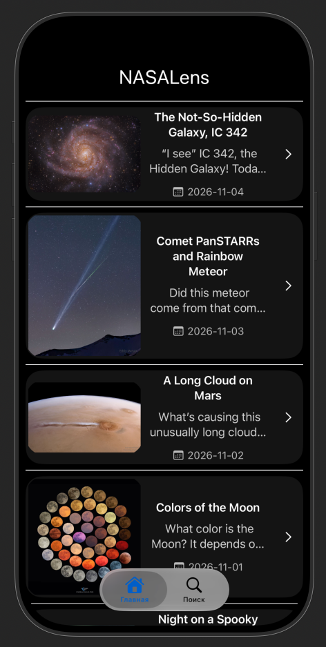

# NASALens

**NASALens** - iOS-приложение для просмотра Astronomy Picture of the Day (APOD) от NASA.

## Возможности

- Просмотр астрономических изображений и описаний NASA
- Открытие отдельной записи с подробной информацией
- Загрузка более ранних публикаций при прокрутке списка

## Технологии

- Swift
- SwiftUI
- NASA APOD API
- URLSession
- MVVM

## Запуск проекта

1. Склонируйте репозиторий.
2. Откройте `NASALens.xcodeproj` в Xcode.
3. Выберите симулятор или подключённое устройство.
4. Соберите и запустите приложение.

## Статус проекта

В разработке.

## Источник данных

Астрономические изображения и описания предоставляются NASA через APOD API.

